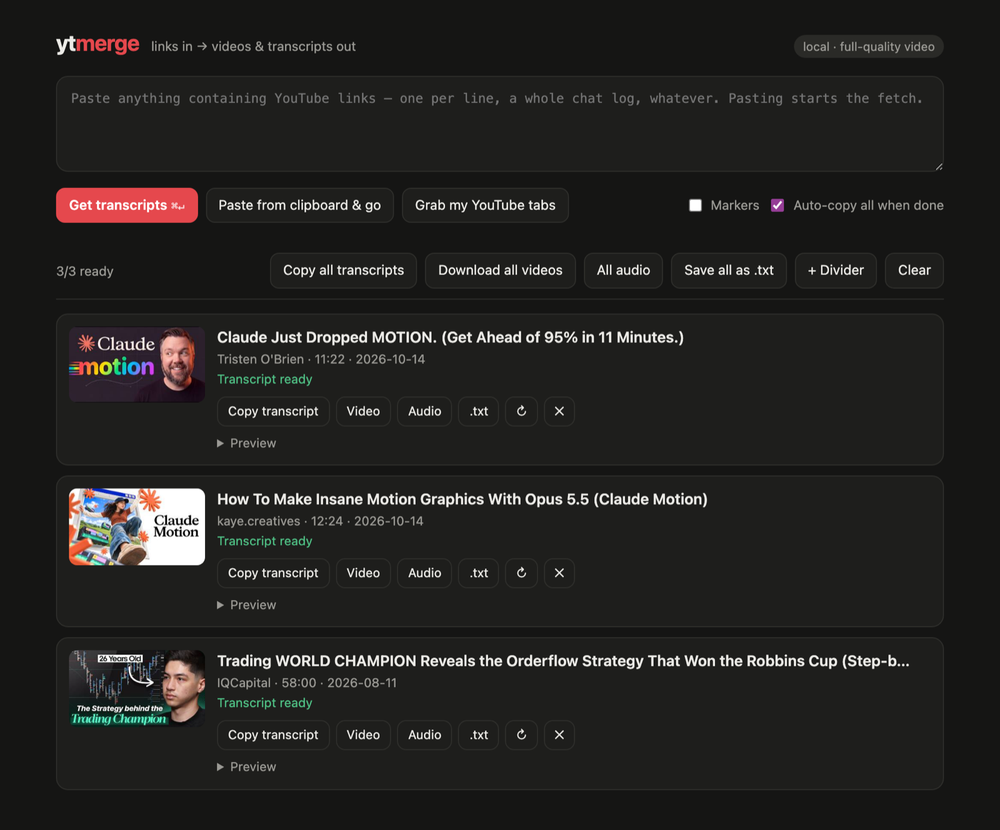

<div align="center">


# ytmerge

**Paste YouTube links. Get the transcripts, the videos, or both.**

[](https://github.com/mal0ware/ytmerge/actions/workflows/ci.yml)

[](LICENSE)



</div>

ytmerge takes any text with YouTube links in it (a list, a chat log, your open browser tabs) and gives you back:

- the full transcript of each video, with timestamps and a metadata header, ready to paste into Claude or another LLM
- the video as an mp4, or just the audio
- one merged copy of every transcript, already on your clipboard

It runs on your own machine. Everything goes through [yt-dlp](https://github.com/yt-dlp/yt-dlp), which ytmerge downloads and keeps up to date for you.

There are two ways to use it: a web page on your computer (easiest, nothing to build) and a command-line tool.

## Web UI

```bash
git clone https://github.com/mal0ware/ytmerge.git
cd ytmerge
./ytmerge-web          # opens http://localhost:8765
```

You need `python3`. For video downloads you also need ffmpeg (`brew install ffmpeg deno` on a Mac). Transcripts and audio work without it.

On the page you can:

- paste links into the box, and fetching starts right away
- click **Grab my YouTube tabs** to pull in every YouTube video open in Opera GX, Chrome, Brave, Edge or Vivaldi (on Windows, add the small tabs extension to get the tabs open right now; setup is under *Web UI in depth* below)
- copy, download or save each transcript, video or audio on its own, or all of them at once
- keep your list between visits, sorted by the day you added things, with your own named dividers and drag-to-reorder
- turn on **Markers** to pin videos for later, flag ones you haven't watched, and mark ones you're done with

To keep it running in the background on a Mac, run `./ytmerge-web install` (it starts at login; `./ytmerge-web uninstall` removes it). The server only listens on `127.0.0.1`, so nothing else on your network can use it.

## Command line

### Install

**macOS / Linux**

```bash
git clone https://github.com/mal0ware/ytmerge.git
cd ytmerge
./install.sh           # installs build deps, builds, copies ytmerge to ~/.local/bin
```

**Windows** (needs [MSYS2](https://www.msys2.org/): `winget install MSYS2.MSYS2`)

```powershell
powershell -ExecutionPolicy Bypass -File .\install.ps1
```

### Use

```bash
ytmerge                          # links from your clipboard
ytmerge links.txt                # links from a file
ytmerge "URL1" "URL2"            # links as arguments (quote them in zsh)
cat urls.txt | ytmerge -         # links from stdin
```

Each video ends up in `downloaded/` as `<title>.mp4` and `<title>.txt`, and all the transcripts land on your clipboard.

| Option | What it does |
| --- | --- |
| `--no-video` | transcripts only, no downloads |
| `--audio` / `--mp3` | audio only (mp3 converts it) |
| `--out DIR` | output folder (default `downloaded`) |
| `--workers N` | parallel downloads (default 4) |
| `--proxy URL` / `--proxy-list FILE` | send requests through a proxy, or rotate through a list |
| `--no-cache` | ignore cached transcripts |
| `--update` | update yt-dlp now |

Tip: bind `~/.local/bin/ytmerge` to a keyboard shortcut (Shortcuts.app on macOS, your desktop's custom shortcuts on Linux). Copy some links, press the keys, and the transcripts are on your clipboard.

## What a transcript looks like

```
================================================================================
TITLE:    The video's title
CHANNEL:  Channel Name
DATE:     2026-08-05
DURATION: 12:34
URL:      https://www.youtube.com/watch?v=...
CHAPTERS: [0:00] Intro | [2:15] Setup | [6:45] Main demo

DESCRIPTION:
The video description...
================================================================================

[0:00] Intro text here.
[0:45] More content.
```

## If YouTube blocks you

Fetch a lot in a short time and YouTube may rate-limit your IP (HTTP 429). ytmerge tells you when that happens. You can wait it out, switch networks (a phone hotspot works), or use proxies:

```bash
./refresh-proxies.sh                                   # fetch a free public proxy list
ytmerge --proxy-list ~/.cache/ytmerge/proxies.txt links.txt
```

Free proxies are hit and miss. A paid rotating proxy is more reliable.

Transcripts are cached in `~/.cache/ytmerge` for 7 days, so fetching the same video again costs nothing.

## Documentation

Click a topic to expand it.

<details>
<summary><b>Web UI in depth</b></summary>

<br>

The web UI is a small Python server (standard library only) plus one HTML page. It uses the same transcript format and the same `~/.cache/ytmerge` cache as the CLI, so the two share cached transcripts and the yt-dlp binary.

**Starting it**

| Command | What it does |
| --- | --- |
| `./ytmerge-web` | start the server and open the page; running it again while it's up just opens the tab |
| `./ytmerge-web install` | macOS: register a LaunchAgent so it starts at login and restarts if it dies |
| `./ytmerge-web uninstall` | macOS: remove the LaunchAgent |
| `YTMERGE_PORT=9000 ./ytmerge-web` | use a different port (default 8765) |

With the LaunchAgent installed, bookmark `http://localhost:8765` or add it to the Dock from Safari (*File → Add to Dock*). The log is at `~/Library/Logs/ytmerge-web.log`.

For an on-demand shortcut instead, add `alias ytm="$HOME/path/to/ytmerge/ytmerge-web"` to `~/.zshrc`. `Ctrl+C` stops it.

**Links that open the page pre-loaded**

- `http://localhost:8765/?q=<text with links>` fetches those links straight away. Handy for a bookmarklet or a Shortcut.
- `http://localhost:8765/?tabs` grabs every open YouTube tab. Bookmark it for a one-click grab.

**Grabbing browser tabs**

There are two ways ytmerge finds your open YouTube tabs. The page tries the first and falls back to the second.

1. **The ytmerge tabs extension** (in `extension/`). It asks the browser for the YouTube tabs open right now, so the list is always current. It works in any Chromium browser on any OS, and it's the way to go on Windows.
2. **The browser's session file.** Chromium browsers record the open tabs in `<profile>/Sessions/Session_*`, and ytmerge reads that file (no history, no closed tabs). Nothing needs installing. On macOS and Linux this gives the tabs open right now. On Windows, a running browser locks that file so nothing else can read it. ytmerge then reads the previous copy, which the browser writes every so often (anywhere from a minute to about an hour old), and the page tells you what time the list is from. Supported: Opera GX, Opera, Chrome, Brave, Edge and Vivaldi on macOS and Windows, and the same minus Opera GX on Linux.

**Installing the tabs extension**

1. Open your browser's extensions page: `opera://extensions` in Opera and Opera GX, `chrome://extensions` in Chrome, `edge://extensions` in Edge, `brave://extensions` in Brave.
2. Turn on **Developer mode**.
3. Click **Load unpacked** and pick the `extension` folder inside your ytmerge clone.
4. Reload the ytmerge page if it's open.

The extension can only see the addresses of YouTube tabs, and it only answers the ytmerge page at `http://localhost:8765`. It doesn't send anything anywhere else, and it skips private/incognito windows unless you allow it there. If you run the web UI on another port (`YTMERGE_PORT`), change `8765` in `extension/manifest.json` to match and reload the extension.

**Downloads and storage**

- Videos and audio are prepared in `~/.cache/ytmerge/media`, handed to your browser's Downloads folder, and deleted from the cache after 24 hours.
- Your list, markers, dividers and order are stored in the browser (localStorage), so they stay between visits but don't follow you to another browser.

**Organizing the list**

- Day lines (*Just now*, *Today*, *Yesterday*, a date, *Earlier*) show where each batch was added. They're labels, not real dividers: a line only shows while its videos sit together in date order, so dragging things out of order hides it. *Just now* marks only the latest batch and fades after 30 minutes.
- **+ Divider** adds a named divider. Drag videos and dividers by the ⠿ handle that appears on hover.
- **Markers** (off by default): 📌 Pin floats a video to the top of its group, ● New flags it as unwatched, ✓ Done dims it and sinks it to the bottom. Filter chips show one kind at a time, and the bulk buttons act on what's shown.

**Security**

The server only listens on `127.0.0.1` and rejects requests with a foreign `Host` or `Origin` header, so other machines and other websites can't drive it.

</details>

<details>
<summary><b>macOS setup for the web UI</b></summary>

<br>

1. python3 is already there if you have the Xcode Command Line Tools (`xcode-select --install`) or a python.org install.
2. ffmpeg is needed for video downloads, because YouTube serves video and audio as separate streams that ffmpeg joins. Transcripts and audio work without it.
   ```bash
   brew install ffmpeg deno   # deno is the JS runtime yt-dlp uses to see every format
   ```
   If brew complains about the Xcode license, run `sudo xcodebuild -license accept` first.
3. yt-dlp downloads itself into `~/.cache/ytmerge/bin` on first run and checks for updates once a day. If `yt-dlp` is already on your PATH (for example from `brew install yt-dlp`), that one is used instead.

</details>

<details>
<summary><b>Building the CLI</b></summary>

<br>

**macOS and Linux:** `./install.sh` detects your OS, installs what's needed, builds with `make`, and copies `ytmerge` to `~/.local/bin/`.

- macOS: Homebrew and the Xcode Command Line Tools; `nlohmann-json` from brew; libcurl from the SDK.
- Linux (apt, dnf or pacman): `build-essential`/`gcc-c++`, `libcurl-dev`, `nlohmann-json3-dev`, plus `xclip`, `wl-clipboard` and `libnotify` for clipboard and notifications.

Make sure `~/.local/bin` is on your PATH:

```bash
export PATH="$HOME/.local/bin:$PATH"   # in ~/.zshrc or ~/.bashrc
```

**Windows:** with MSYS2 installed, `install.ps1` installs the pacman packages, runs `make`, installs to `%LOCALAPPDATA%\ytmerge\bin` (added to your user PATH), and copies the MSYS2 runtime DLLs next to the exe so it runs from any shell.

To build by hand instead:

1. Open the **MSYS2 UCRT64** shell.
2. Install the toolchain and libraries:
   ```bash
   pacman -S --needed mingw-w64-ucrt-x86_64-toolchain \
                       mingw-w64-ucrt-x86_64-curl \
                       mingw-w64-ucrt-x86_64-nlohmann-json \
                       make pkgconf
   ```
3. Run `make` in the repo. You get `ytmerge.exe`.

The exe needs the MSYS2 UCRT64 runtime DLLs (`libcurl-4.dll`, `libstdc++-6.dll` and others). Outside an MSYS2 shell, copy them next to it; `ldd ytmerge.exe` lists them.

</details>

<details>
<summary><b>CLI behavior</b></summary>

<br>

**Input.** With no arguments, ytmerge reads links from the clipboard and falls back to `./links.txt`. You can also pass a file, URLs as arguments, or `-` for stdin. In zsh, always quote URLs: the `?` in `?v=` is a glob character and an unquoted URL gives `zsh: no matches found`.

**Links it understands.** `youtube.com/watch?v=`, `youtu.be/`, `youtube.com/shorts/` and `youtube.com/embed/`, anywhere in the text. Duplicates are dropped.

**Output.** For each video, `downloaded/<title>.mp4` (best mp4 + m4a) and `downloaded/<title>.txt`. Output order follows input order, whichever download finishes first. Videos download in parallel, 4 at a time by default. All transcripts are merged, separated by blank lines, and put on the clipboard.

**Platforms.** Clipboard and notifications are the only OS-specific parts; everything else is plain C++20.

| | Clipboard | Notification when done |
| --- | --- | --- |
| macOS | `pbcopy` / `pbpaste` | notification center |
| Linux | `wl-copy` on Wayland, else `xclip` or `xsel` | `notify-send` |
| Windows | Win32 clipboard API | none; status prints to the terminal |

**All options**

```
--no-video           transcripts + metadata only (no download)
--audio              audio-only download (best available format)
--mp3                audio-only download, converted to mp3
--out DIR            output directory (default: downloaded)
--workers N          parallel workers (default 4)
--proxy URL          single proxy for all requests
--proxy-list FILE    one proxy per line; round-robin with cooldown on 429
--no-cache           skip disk cache for this run
--update             force a yt-dlp self-update check now
-h, --help           this message
```

</details>

<details>
<summary><b>Transcript format</b></summary>

<br>

```
================================================================================
TITLE:    The video's actual title
CHANNEL:  Channel Name
DATE:     2026-08-05
DURATION: 12:34
VIEWS:    45000        LIKES: 1200
URL:      https://www.youtube.com/watch?v=...
TAGS:     python, tutorial, coding
CHAPTERS: [0:00] Intro | [2:15] Setup | [6:45] Main demo

DESCRIPTION:
Full video description text here...
================================================================================

[0:00] Intro text here.
[0:45] More content.
[2:15] Setup section begins...
```

The clear delimiters help an LLM keep track of which video a point came from when you paste several at once.

</details>

<details>
<summary><b>Rate limits and proxies</b></summary>

<br>

YouTube rate-limits its captions endpoint per IP. From a home connection you can usually fetch dozens of transcripts without trouble, but many runs in a short window will get you an HTTP 429. ytmerge says so plainly:

```
[1/1] InH25PzMqpk  FAIL: ip blocked (429)
all 1 failed — 1 ip blocked (429)
  hint: YouTube has rate-limited this IP. Either:
    - switch network (phone hotspot, VPN, different wifi)
    - wait a few hours
    - re-run with --proxy URL or --proxy-list FILE
```

Your options:

1. **Wait.** Blocks clear within minutes to a few hours.
2. **Change your IP.** A phone hotspot for 30 seconds, a VPN, or another network.
3. **Use proxies.** Put one HTTP or SOCKS proxy URL per line in a file (lines starting with `#` are ignored) and pass `--proxy-list FILE`. Workers rotate through the list, and a proxy that hits a 429 rests for 10 minutes.

`./refresh-proxies.sh` writes about 100 fresh public proxies to `~/.cache/ytmerge/proxies.txt`. Expect most of them to be dead or blocked; often only 5 to 30% reach YouTube, which is what the rotation is built for. Lists go stale within hours, so re-run it now and then. Public proxies are untrusted: HTTPS protects the content, and ytmerge sends no credentials, but they can see which URLs you request.

More reliable options: a rotating residential proxy such as Webshare (about $1/month, one URL that rotates IPs for you), or your VPN's SOCKS endpoint if it has one (Mullvad, ProtonVPN and others).

Browser cookies don't help here; the limit is on the IP whether you're signed in or not.

The `HTTPS_PROXY` and `ALL_PROXY` environment variables are picked up automatically. `--proxy` overrides them.

</details>

<details>
<summary><b>Cache</b></summary>

<br>

Transcripts are cached at `~/.cache/ytmerge/<video_id>.txt` (or under `$XDG_CACHE_HOME`) for 7 days, so re-running on the same links is free. `--no-cache` skips the cache for one run, and `rm -rf ~/.cache/ytmerge` clears it.

</details>

<details>
<summary><b>Keyboard shortcuts</b></summary>

<br>

**macOS (Shortcuts.app)**

1. Open Shortcuts.app and click **+**. Name it `ytmerge`.
2. Add a **Run Shell Script** action. Set the shell to `/bin/zsh` and the script to `~/.local/bin/ytmerge`.
3. Click the ⓘ icon, choose **Add Keyboard Shortcut**, and press your combo (for example `⌃⌥⌘Y`).
4. Optionally tick **Pin in Menu Bar**.

No code signing needed; Shortcuts runs the script as you.

**Linux**

- GNOME: Settings → Keyboard → View and Customize Shortcuts → Custom Shortcuts, with the command `~/.local/bin/ytmerge`.
- KDE Plasma: System Settings → Shortcuts → Custom Shortcuts → New → Global Shortcut → Command/URL.
- i3, sway, Hyprland and others: add a `bindsym` or `bind` line for the binary.

**Windows**

- PowerToys Keyboard Manager with a small `.cmd` file that calls `ytmerge.exe`, or
- AutoHotkey v2 with a hotkey that runs `Run "ytmerge.exe"`.

</details>

## License

MIT. See [LICENSE](LICENSE).
